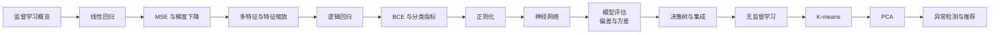

# 学习路线：从监督到无监督

这是一条根据现有代码和实验逐步整理的路线，不预设固定课程目录；后续主题以实际复现和问题记录为准。

## 当前阶段

1. [[MachineLearning/Linear Regression/Linear Regression MOC|Linear Regression]]：已学过，仓库已整理模型、损失、优化与配套实现。
2. [[MachineLearning/Logistic Regression/Logistic Regression MOC|Logistic Regression]]：已学过，仓库已整理概率分类、BCE、正则化、阈值与基础诊断。
3. [[MachineLearning/Neural Network/Neural Network MOC|Neural Network / MLP]]：已学过，仓库已有入门笔记、二分类数据和 Keras 实验。待复习前向传播和反向传播。
4. Decision Tree 与 Random Forest：已学过，笔记尚未整理到仓库。模型评估、偏差/方差与学习曲线也待系统整理。
5. CNN 是下一阶段的学习主题，尚未正式完成。Transformer 是未来方向。

> [!tip] 每个主题的复现模板
> 问题类型 → 数据划分 → 假设函数 → 目标函数 → 优化方法 → 向量化 → 基线库实现 → 泛化诊断。
